# Torre de Belém, Jerónimos y guía de Belém: datos verificados y fotos reales (1/11/2026)

José pide modificar sus páginas, no crear otras. Se tocan tres URLs vivas y ninguna cambia:
- `/actividades/torre-de-belem`: guía de entradas en la ficha (`src/data/ticket-guides.ts`).
- `/blog/monasterio-jeronimos-entradas`: artículo. Se conservan el título y los h2, porque es la única de las tres con clics (Search Console, 24/07–23/10: 1 clic, 121 impresiones, posición 8,2).
- `/blog/belem-barrio-guia`: guía de la zona (0 clics, 101 impresiones, posición 15,8). Se reescribe sin competir con las otras dos: sin precios y sin "entradas" en el h1 ni en los h2.
- `/actividades/mosteiro-jeronimos` hace un 301 a `/blog/monasterio-jeronimos-entradas` y **no se toca**.

Los datos salen de `v4/research/belem.md`, comprobado el 31/10/2026 en la web oficial del monumento, Museus e Monumentos, la venta oficial MEO Blueticket, Património Cultural, UNESCO, Carris y CP.

## Línea base (producción, 1/11/2026 00:30, hora de Lisboa)
Lighthouse (Perf/A11y/BP/SEO) en producción:
- Torre: móvil 93/100/100/100, escritorio 98/100/100/100.
- Jerónimos: móvil 91/100/100/100, escritorio 99/100/100/100.
- Belém: móvil 92/100/100/100, escritorio 100/100/100/100.

## Qué se quitó por no tener fuente o por contradecir la fuente
- **Torre:**
  - Hora de apertura 9:30: no se publica hasta que José la apruebe. Se deja "martes a domingo, última entrada 17:00" y una frase neutra que remite a la web oficial.
  - "Escalera de caracol muy estrecha" (3 veces) y "unos 45 minutos dentro", con su pregunta frecuente.
  - "15,92 € en total" y "gastos de gestión": el importe aparece en la venta oficial, pero el motivo no se explica en ningún sitio.
  - "8 minutos" en tren y "unos 10 minutos a pie".
- **Jerónimos:**
  - "19,11 €" y "gastos de gestión".
  - Los precios de Tiqets "19,50 €" y "34 €", y "sale 1 € más caro": cambian con la fecha.
  - "8 minutos", "cada 20 minutos", "unos 10 minutos a pie" y los autobuses 728 y 729 (la investigación no los confirma).
  - "Cuenta al menos una hora" y "Calcula una hora dentro", con la pregunta frecuente de la duración.
  - "Unos cinco minutos a pie" y "algo más de 1 km".
- **Belém:** reescrita entera. Fuera quedan los superlativos sin fuente ("el monasterio más bello", "objetivamente diferente", "la pastelería más famosa del mundo"), "1516-1521" (contradice 1514), "cinco pisos con escaleras estrechísimas", las colas de una hora y de 40 minutos, la "Receita Secreta en tres personas", la "vintena da pimenta" y la ruta con duraciones inventadas.

## Qué se añadió
- **Torre:**
  - Sección "Un poco de historia": 1514, Francisco de Arruda, la roca en el río y el rinoceronte de 1515 (Museus e Monumentos, Património Cultural y UNESCO).
  - "Pack de Tiqets, no entrada combinada oficial".
  - Paradas del 15E y aviso de que no todos los trenes paran en Belém.
- **Jerónimos:**
  - Párrafo de historia (D. Manuel I, Restelo, Boytac y Castilho, UNESCO).
  - Las colas de más de 2 horas, atribuidas a la venta oficial con fecha.
  - Enlace a la ficha de la Torre.
- **Belém:** guía corta que enlaza a las dos; la lista de fuentes va en el desplegable que ya existía.
- **Las fuentes nuevas** van en el desplegable cerrado que ya usa el repo ("Datos verificados").

## Fotos
Las fotos de IA se sustituyen por fotos de Wikimedia Commons con autor y licencia comprobados:
- `torre-de-belem-lisboa.webp` (IA) se cambia por `/images/commons/torre-belem-werner-wikimedia.webp` (Berthold Werner, CC BY-SA 4.0) en la ficha de la Torre, su tarjeta de actividad y la tarjeta de Tiqets.
- `mosteiro-dos-jeronimos-claustro.webp` (IA) se cambia por `/images/commons/claustro-jeronimos-halun-wikimedia.webp` (Jakub Hałun, CC BY 4.0) en el artículo de los Jerónimos, en la tarjeta del artículo de arquitectura manuelina y en la tarjeta de Tiqets.
- Belém usa `torre-belem-puente-lisbon-photoshoots-wikimedia.webp` (Lisbon Photoshoots, CC BY-SA 4.0): la Torre con el Puente 25 de Abril. Sustituye a la vista de los Jerónimos desde el Padrão, que en móvil pesaba demasiado (ver la revisión SEO, más abajo).
- **Crédito visible:** `ArticleHero` muestra el crédito (autor, licencia con enlace y "vía Wikimedia Commons") bajo la portada cuando la foto está en `photo-credits.ts`. Afecta a las portadas de artículos con foto de Commons, como Portugal en 7 días (Pena).
- **Preparación de las fotos:** reducidas a 1600 px y pasadas a WebP, sin recorte. next/image sirve la versión móvil y hace la precarga de la portada.
- **Siguen con la foto IA de la Torre** (fuera de este PR): `HomeEssentials`, `FreeTourLiveFinder`, `affiliate-links.ts` y `english-walking-tours.json`.

## Afiliados
- Se conservan los botones de Tiqets: `web_guia_torre-de-belem` (Torre), `web_blog_monasterio-jeronimos-entradas` y `web_blog_monasterio-jeronimos-entradas_pack-torre` (Jerónimos: entrada y pack) y `web_blog_belem-barrio-guia` (Belém). Todos llevan `partner` y `rel="sponsored"`.
- El bloque del pack en Belém conserva su `beforeHeading` original (`pasteis-de-belem-la-fila-que-vale-la-pena`). Ese h2 ya no existe, así que el bloque sale al final del artículo, como en el resto de casos sin encabezado.

## Pruebas
- `typecheck`, ESLint de los archivos tocados y `build`: OK.
- `smoke:sitemap`: 67/67. Ajuste: la prueba de imágenes de actividades acepta también `/images/commons/`.
- `smoke:seo-migration`: 1530 comprobaciones, 0 fallos (107 URLs del sitemap, 16 redirecciones).
- `smoke:technical-quality`: 1220 comprobaciones, 0 fallos.
- `smoke:editorial-template`: no se puede ejecutar porque falta `.snapshots/editorial-phase2-base.json` (no está en el repo).
- **Diff de URLs:** el sitemap es idéntico (107). El lastmod pasa al 2026-11-01 solo en las tres páginas cambiadas y en /blog, que toma la fecha del artículo más reciente. El Oceanário sigue en 2026-10-25.
- **Enlaces externos nuevos:** responden 200 (Património Cultural ×2, UNESCO, Carris 15E, CP, web oficial, Pastéis de Belém, Tiqets, MEO Blueticket y MMP).
- **Lighthouse** en el build local (`next start`, sin CDN):
  - Torre: móvil 88/100/100/100, escritorio 100/100/100/100.
  - Jerónimos: móvil 89/100/100/100, escritorio 100/100/100/100.
  - Belém: móvil 87/100/100/100, escritorio 99/100/100/100.

  El rendimiento en móvil no es comparable con producción, porque en local el optimizador de imágenes trabaja en frío. Hay que medirlo en la Preview de Vercel.

## Capturas (antes: producción; después: build de esta rama)
| Página | Antes | Después |
|---|---|---|
| Torre, escritorio | 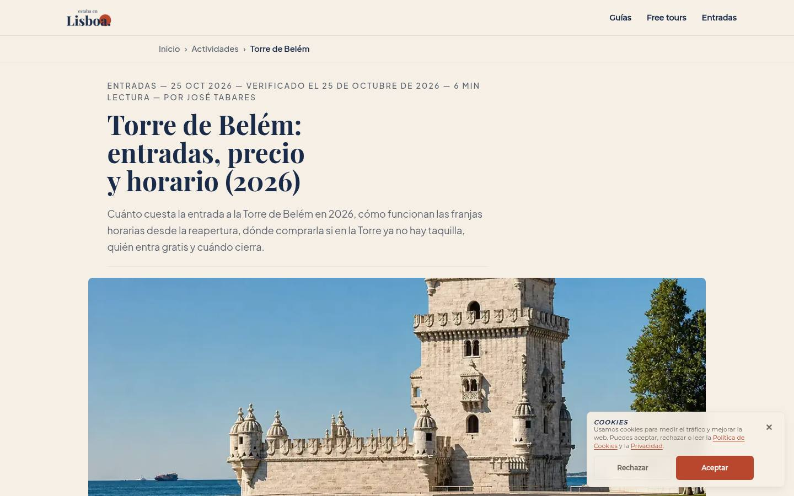 | 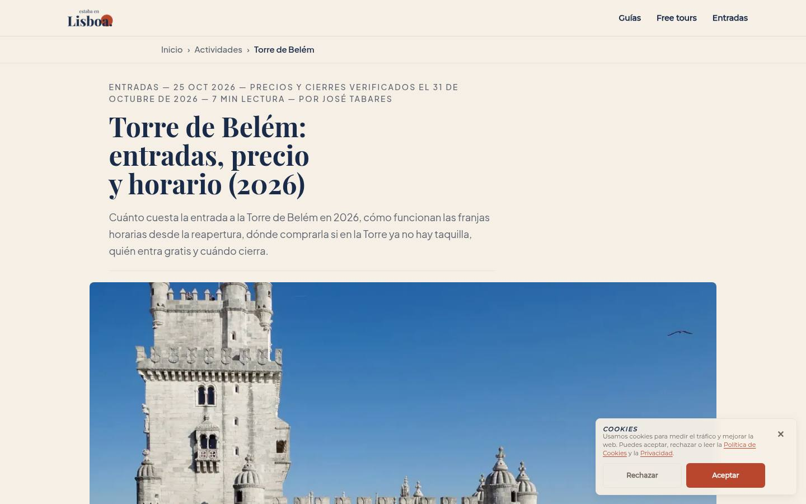 |
| Torre, móvil | 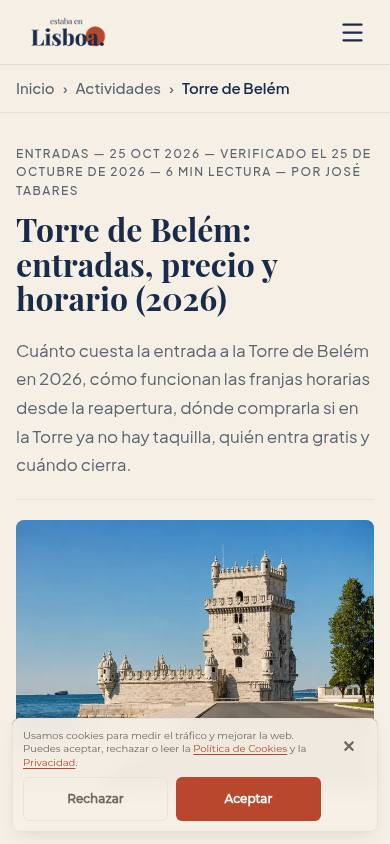 | 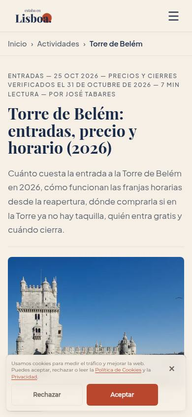 |
| Jerónimos, escritorio | 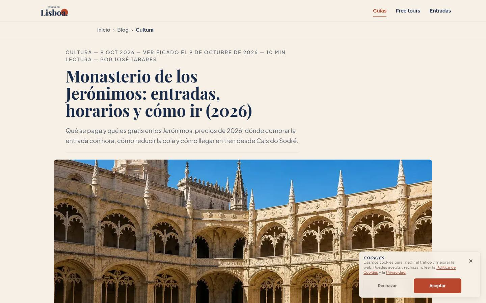 | 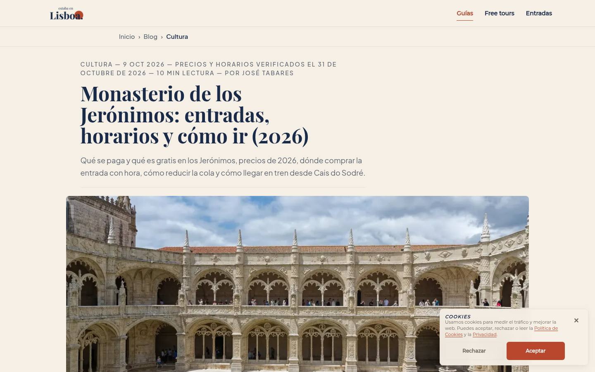 |
| Jerónimos, móvil | 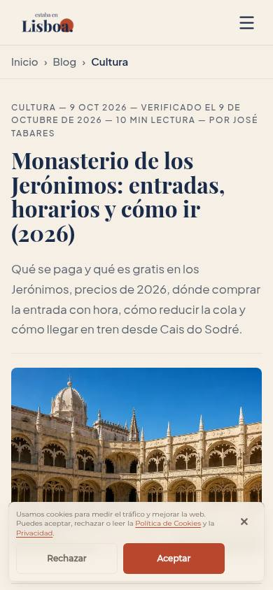 | 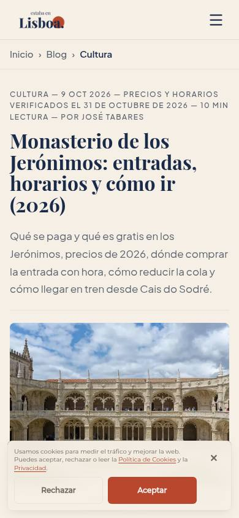 |
| Belém, escritorio | 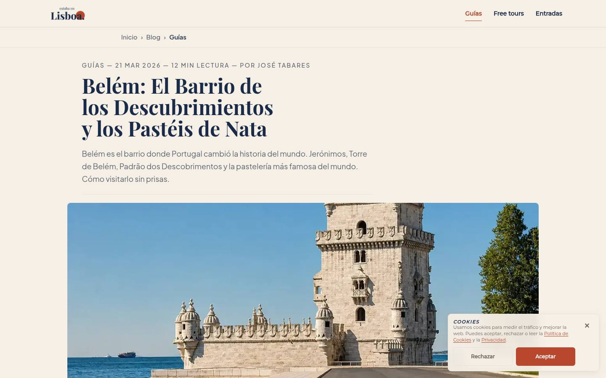 | 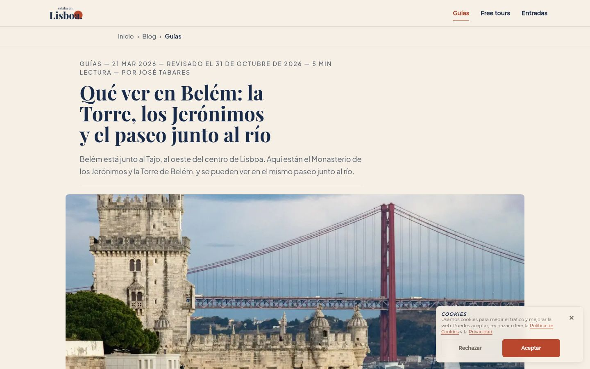 |
| Belém, móvil | 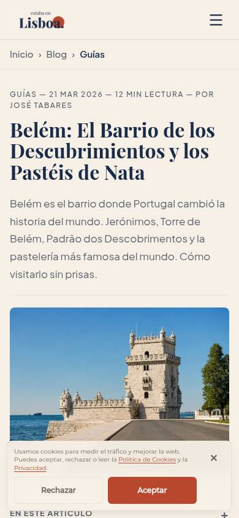 | 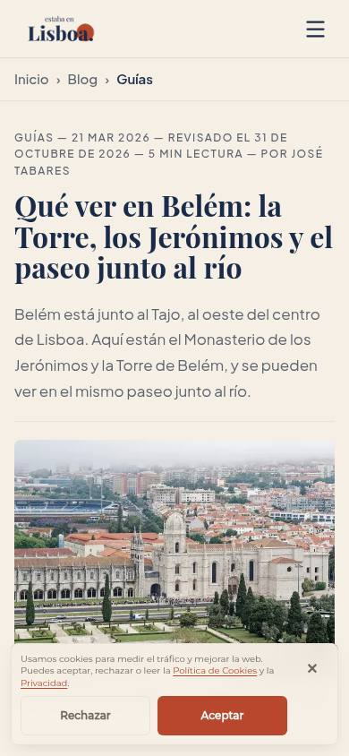 |

## Revisión de 1 Millon (1/11/2026)
1. **Crédito visible junto a las fotos de Commons en las tarjetas:**
   - En `ActivityCard` (/actividades y recomendaciones) y en `EditorialArticleCard` (listado del blog: destacada, rejilla y compacta).
   - Como toda la tarjeta es un enlace, el crédito va en texto bajo la foto, igual que en `BookingCard`: "Foto: Autor / Wikimedia Commons, licencia (reducida y convertida a WebP)". Las licencias enlazadas siguen en la portada del artículo y en las fuentes.
   - En móvil, `ActivityCard.module.css` le da su propia fila en la tarjeta compacta.
2. **"(reducida y convertida a WebP)"** aparece en todos los créditos visibles:
   - Portada del artículo (`ArticleHero`).
   - Tarjetas de reserva (`BookingCard`, a través de `formatPhotoCreditShort`).
   - Lista de créditos de /comprar-entradas.
   - Páginas en inglés: `EnglishArticle` y `EnglishVisitChoices`, como "resized and converted to WebP".
   - Sale de `photoAdaptation()` en `photo-credits.ts`. Una foto servida sin cambios llevaría `unmodified: true`.
   - `photo-credits.ts` y el componente nuevo `PhotoCreditLine.tsx` son idénticos a los del PR #133.
3. **Torre, comprobado el 1/11/2026:**
   - **La directora y los "20 minutos":** la fuente es la noticia de Lusa en [Observador (26/05/2026)](https://observador.pt/2026/05/26/torre-de-belem-reabre-a-brilhar-e-com-novo-sistema-de-entradas-para-reduzir-filas/). Cita a Margarida Donas Botto: "a espera será no máximo de uns 20 minutos". Se mantiene la frase, ahora atribuida con su nombre, el medio y la fecha. La fuente en el desplegable se llama ahora "Observador (Lusa): la directora calcula una espera de unos 20 minutos como mucho".
   - **"Unas 60 personas cada media hora, 900 al día":** solo lo dice la directora en esa noticia. No aparece ni en la web oficial (/visitar) ni en la venta oficial MMP (MEO Blueticket). **Se quita** en 4 sitios: la metadescripción, la entradilla, el párrafo de "Franjas horarias y aforo" y la pregunta frecuente del aforo. Queda "la entrada va con día y franja horaria", que sí está en la venta oficial.
   - **"El quiosco cierra a las 16:30": se mantiene.** La web oficial dice "A bilheteira encerra às 16h30 - Quiosque situado no espaço fronteiro ao monumento com emissão física de bilhetes para o Mosteiro dos Jerónimos e para a Torre de Belém". Observador (Lusa) confirma la venta en persona "na bilheteira do Mosteiro dos Jerónimos".
   - La fuente de Renascença se renombra: no la he podido abrir hoy (responde 403), así que ya no se le atribuye el aforo.

| Sitio | Antes | Después |
|---|---|---|
| Tarjeta de /actividades, móvil | 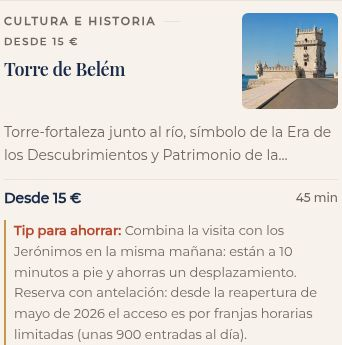 | 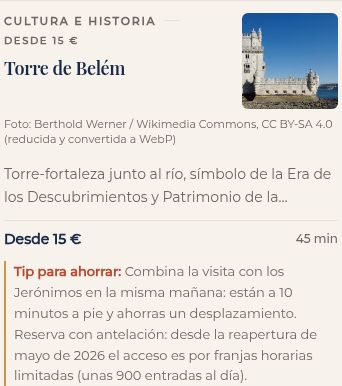 |
| Tarjeta de /actividades, escritorio | | 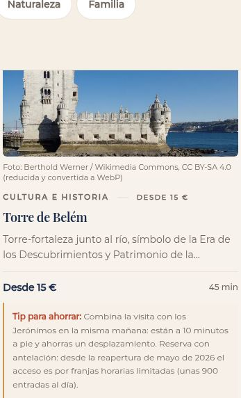 |
| Tarjeta del blog | 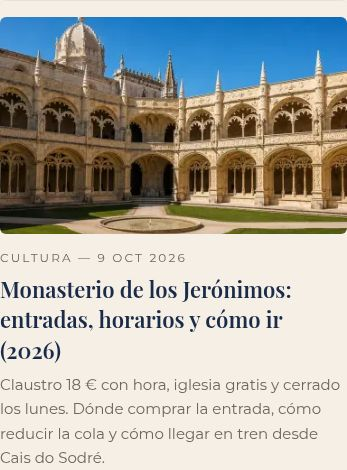 | 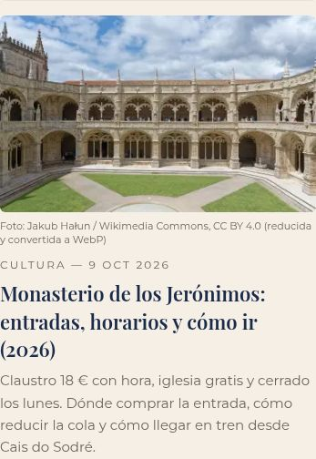 |

**Pruebas tras la revisión:**
- `typecheck`, ESLint de los archivos tocados y `build`: OK.
- `smoke:sitemap`: 67/67.
- `smoke:seo-migration`: 1530 comprobaciones, 0 fallos.
- `smoke:technical-quality`: 1220 comprobaciones, 0 fallos.
- Sitemap idéntico al de producción (107 URLs).

**Pendiente para José:**
- **Hora de apertura de la Torre:** el 1/11/2026, la web oficial (/visitar) y la ficha de Museus e Monumentos dicen las dos "Terça a Domingo, das 9h30 às 17h30" para la Torre. Se puede volver a poner la apertura de las 9:30 si José lo aprueba.
- **Tarjeta de la Torre en /actividades** (`activities.ts`, fuera del alcance de este PR): sigue diciendo "45 min", "a 10 minutos a pie" y "unas 900 entradas al día". Ninguna de las tres tiene fuente oficial.

## Revisión SEO de Captador Ventas (1/11/2026)
1. **Oceanário:** se revierte un cambio que no tocaba. Vuelven `fechaActualizacion` "Verificado el 25 de octubre de 2026", `dateModified` 2026-10-25 y 6 minutos de lectura, y su lastmod en el sitemap vuelve a 2026-10-25, igual que en producción. Las fechas nuevas quedan solo en la Torre, los Jerónimos y Belém.
2. **Foto de Belém en móvil:** `jeronimos-torre-belem-wikimedia.webp` pesaba 167 KB en la versión de 1080 px. Ni recomprimiéndola ni recortándola bajaba de 100 KB sin emborronarla. Se cambia por `torre/torre-y-puente-25-abril.jpg` de `photos-commons`: Lisbon Photoshoots, CC BY-SA 4.0, [ficha en Commons](https://commons.wikimedia.org/wiki/File:Bel%C3%A9m_Tower_and_the_25_de_Abril_Bridge_in_the_background.jpg), comprobada el 1/11/2026 y reducida a 1600 px en WebP.
   - Pesos de la versión optimizada: 32 KB (640), 50 KB (828) y 79 KB (1080).
   - Crédito visible con "(reducida y convertida a WebP)"; nuevo alt; entrada en `photo-credits.ts` y `CREDITOS.md`.
   - Lighthouse móvil de Belém en el build local: 93/100/100/100, LCP 3,2 s. Antes daba 87.
   - La foto de los Jerónimos desde el Padrão sigue en la tarjeta del pack (`bookings.ts`).
3. **Metadescripción de Belém:** queda en 145 caracteres: "Qué ver en Belém: los Jerónimos, la Torre de Belém, el Padrão dos Descobrimentos y los Pastéis de Belém, y cómo llegar desde el centro de Lisboa."
4. **Belém cambia título, h1 y h2 a propósito.** La página no tenía tráfico que proteger: 0 clics y posición media 15,8. El título y los h2 de los Jerónimos sí se mantienen (es la única de las tres con clics).
5. **Cifras sin fuente:**
   - En `activities.ts` se quitan "45 min" (Torre) y "1 h" (Jerónimos), que salían en las tarjetas, incluida la de los Jerónimos en la página de la Torre. `duration` pasa a ser opcional y, si falta, la tarjeta y la ficha no muestran nada.
   - En el consejo de la Torre se quitan "a 10 minutos a pie" y "unas 900 entradas al día". Queda "los dos están en Belém" y "se entra por franjas horarias y las entradas se agotan a menudo", que dice la web oficial.
6. **"250 metros":** se añade a las fuentes de la Torre la ficha oficial del claustro en MEO Blueticket (evento 14759). Dice "a Torre construiu-se no rio, a 250 metros da margem, sobre um afloramento basáltico".
7. **Hora de apertura:** la frase pasa a ser "La hora de apertura, mírala en la web oficial del monumento antes de ir.", sin hablar de discrepancias. Hoy (1/11) museusemonumentos.pt y la web oficial dicen las dos 9:30–17:30, con última entrada a las 17:00. **La hora no se publica hasta que José lo apruebe.**
8. **Crédito y metatexto:**
   - La foto CC BY del claustro salía sin crédito en las tarjetas de "Relacionadas" (`ArticleRelated`). Ahora lleva crédito en texto, como el resto de tarjetas.
   - Se quita el metatexto "esta página es para organizar la zona" (Belém) y "Fuentes: …, enlazadas al final" (Torre).
   - Se revierte el cambio de `beforeHeading` de Belém.
9. **Jerónimos:** la entrada y el pack de Tiqets compartían `tq_campaign`. El pack pasa a `web_blog_monasterio-jeronimos-entradas_pack-torre`, con un campo nuevo `campaignSuffix` en el placement. La entrada conserva `web_blog_monasterio-jeronimos-entradas`. No cambian ni `partner` ni las URLs de destino.

**Para que lo vea José (fuera de las tres páginas, sin tocar):**
- La foto de `/blog/arquitectura-manuelina-lisboa` ya es la del claustro de Hałun. En `main` sigue la de IA, que se cambia en este PR.
- Las tarjetas de /actividades de la Torre y los Jerónimos cambian de foto y pierden la duración. Además, su texto `experiencia` en `activities.ts` aún dice "cinco pisos… escalera de caracol", "cuarenta minutos", "diez minutos a pie" y "unos veinte minutos". Hoy no se muestra, porque las dos fichas tienen guía propia o redirección.
- El texto del bloque de Tiqets de los Jerónimos dice "Es el billete oficial del claustro", aunque se compra en Tiqets. No se ha tocado.

**Pruebas:**
- `typecheck`: OK.
- `lint`: 0 errores; queda 1 aviso que ya existía en `ItineraryContextualCta.tsx`.
- `build`: OK.
- `smoke:sitemap`: 67/67.
- `smoke:seo-migration`: 1530 comprobaciones, 0 fallos.
- `smoke:technical-quality`: 1220 comprobaciones, 0 fallos.
- **Diff de URLs:** idéntico (107).
- **Diff de lastmod frente a producción:** solo cambian la Torre, los Jerónimos, Belém y /blog.

| Belém tras la revisión | Móvil | Escritorio |
|---|---|---|
| Después |  |  |
