# Torre, Jerónimos y Belém, rehecho sobre el rediseño (2 de noviembre de 2026)

Sustituye al PR #132, que chocaba con `main` después del rediseño editorial (7e7aa32). El contenido es el mismo que se revisó en f58d4c3. El detalle de datos, fuentes y decisiones sigue en [belem-torre-jeronimos-2026-11-01.md](belem-torre-jeronimos-2026-11-01.md); las capturas de ese documento son de la web anterior al rediseño.

## Qué ya traía main y se reutiliza

- `src/data/photo-credits.ts` con las tres fotos de Commons (Werner, Hałun y Lisbon Photoshoots) y `photoAdaptation()`.
- `PhotoAttribution` (créditos plegables) en portadas, tarjetas de actividades, tarjetas del blog y relacionados. Por eso no entra `PhotoCreditLine.tsx` ni los pies de crédito propios del PR #132.
- Los archivos de `public/images/commons/` y `CREDITOS.md`.

## Qué cambia respecto a main

- `/actividades/torre-de-belem`: fuera "unas 60 personas cada media hora, unas 900 al día", "unos 45 minutos dentro", "15,92 € en total" y la "escalera muy estrecha". La hora de apertura no se pone: la página dice que se mire en la web oficial. Se añaden historia con fuente (Património Cultural, UNESCO, Blueticket para los 250 metros) y la frase de la directora atribuida a Observador/Lusa.
- `/blog/monasterio-jeronimos-entradas`: el pack de Tiqets se explica como producto de Tiqets y su botón lleva `tq_campaign` propio (`web_blog_monasterio-jeronimos-entradas_pack-torre`). Título y h2 iguales.
- `/blog/belem-barrio-guia`: portada de Lisbon Photoshoots (CC BY-SA 4.0) en `editorial-photo-policy.ts`, para no repetir la foto de Werner que usa la Torre. Meta descripción de 145 caracteres. Cambian título, H1 y h2 (decisión pendiente de José).
- Tarjetas de Torre y Jerónimos sin duración sin fuente ("45 min", "1 h").
- Las páginas en inglés añaden "resized and converted to WebP" al crédito.
- Oceanário sin tocar (dateModified 2026-10-25).

## Comprobaciones (build local, 2/11/2026)

typecheck y build OK; lint 0 errores (2 avisos que ya están en main). smoke:sitemap 67/67, smoke:seo-migration 1530/0 (108 URLs, 16 redirecciones), smoke:technical-quality 1220/0, test:blog-chronology, smoke:grok-redesign 45/0, smoke:grok-rendered 27/0, smoke:tiqets, smoke:titles, smoke:activities, smoke:free-tours OK. smoke:blog y smoke:english-pilot fallan igual en main (mismos fallos, antiguos). Sitemap idéntico al de main (108).

## Capturas (antes = main 7e7aa32, después = esta rama; build local)

| Página | Antes | Después |
|---|---|---|
| Torre, móvil | 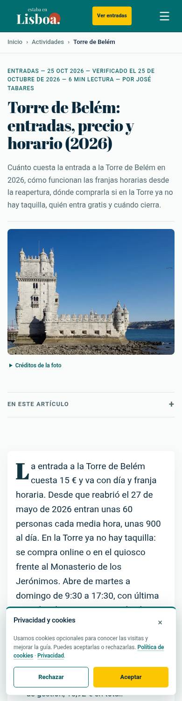 | 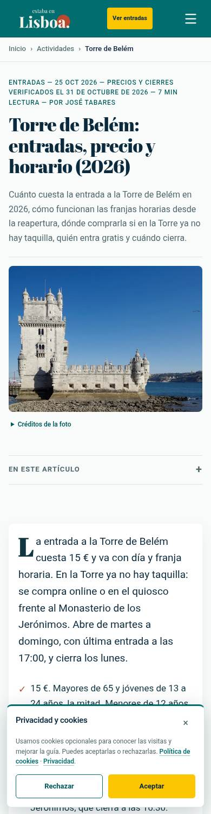 |
| Torre, escritorio | 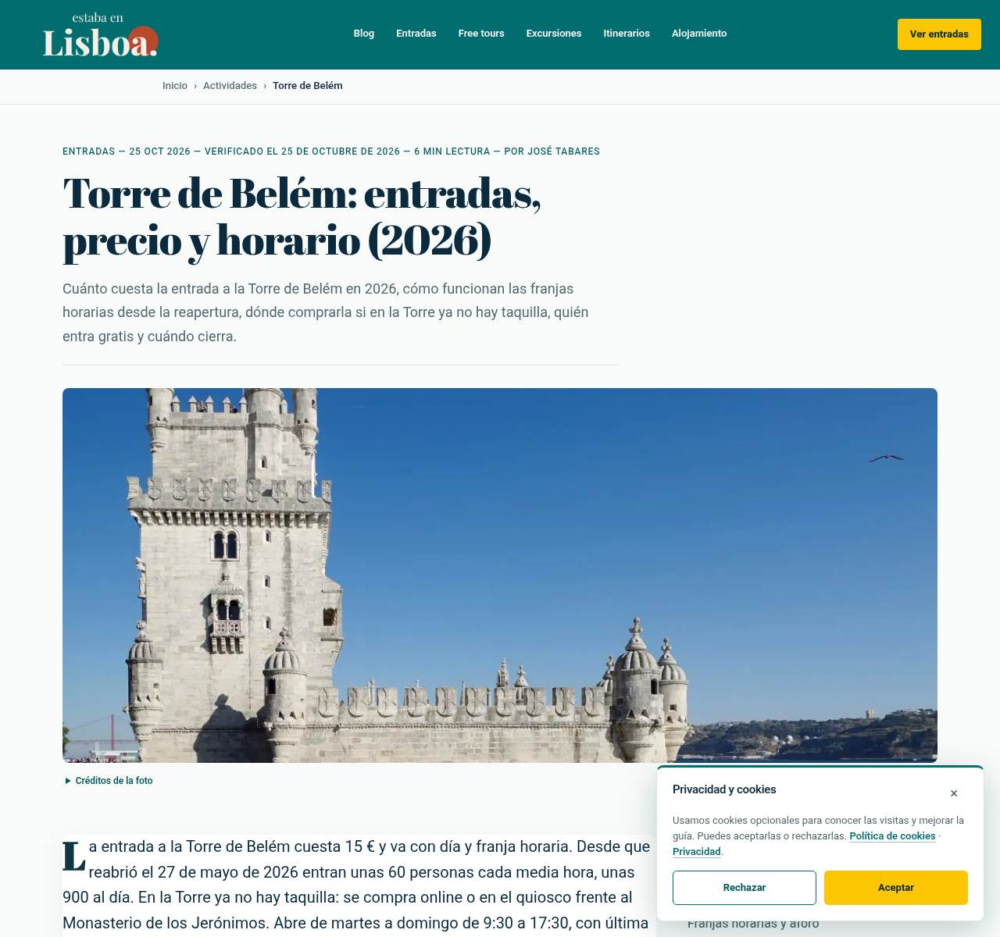 | 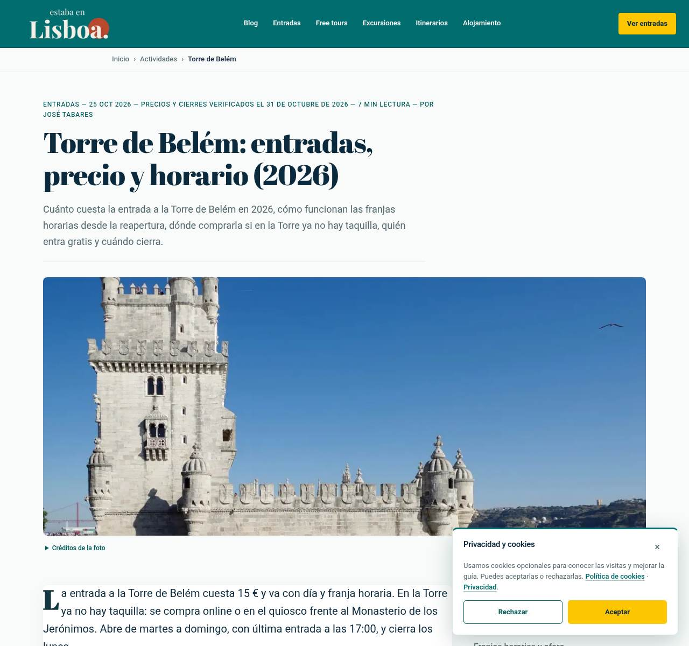 |
| Jerónimos, móvil | 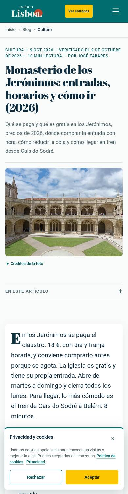 | 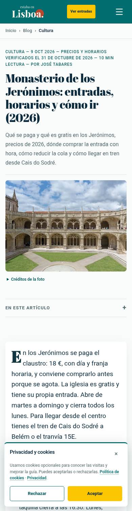 |
| Jerónimos, escritorio | 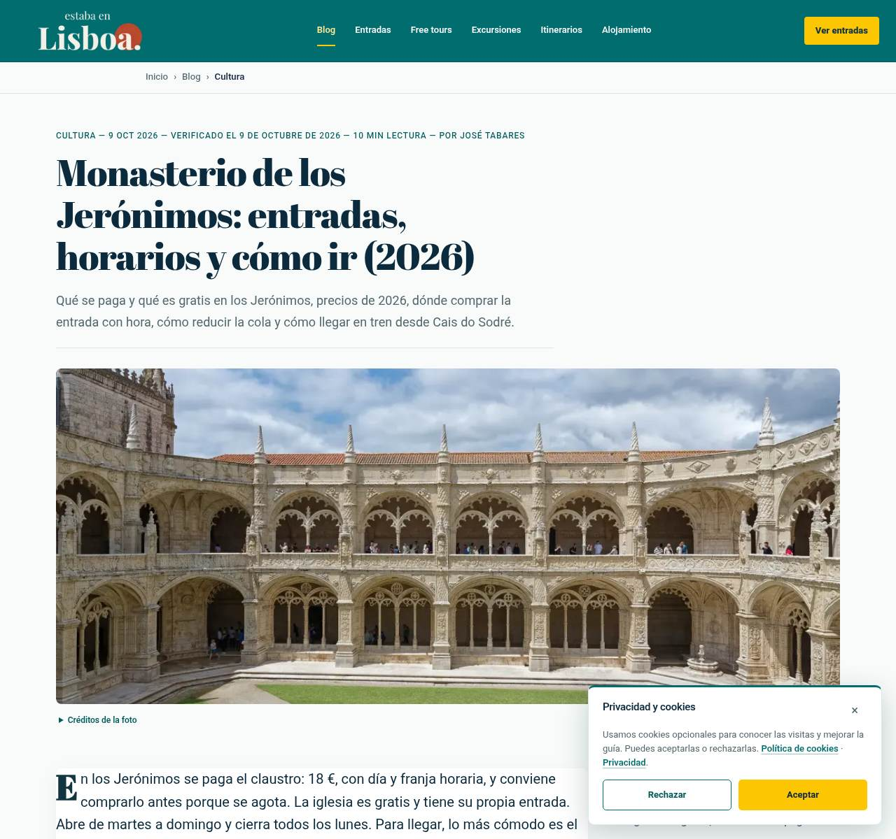 | 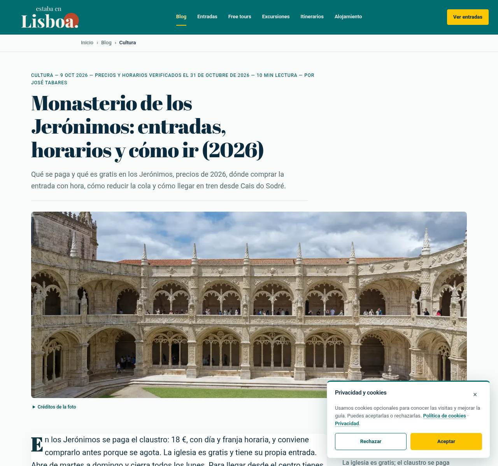 |
| Belém, móvil | 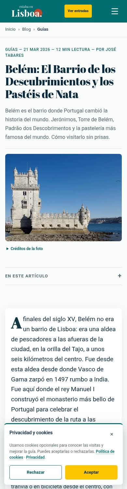 | 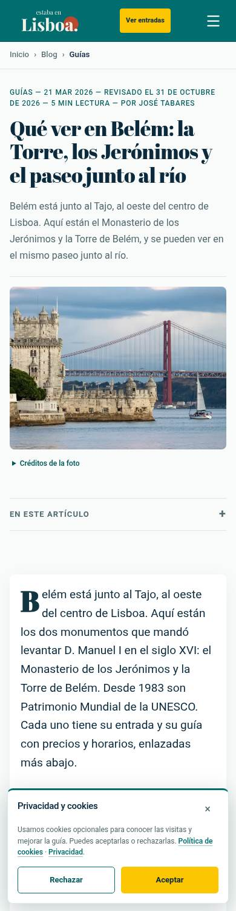 |
| Belém, escritorio | 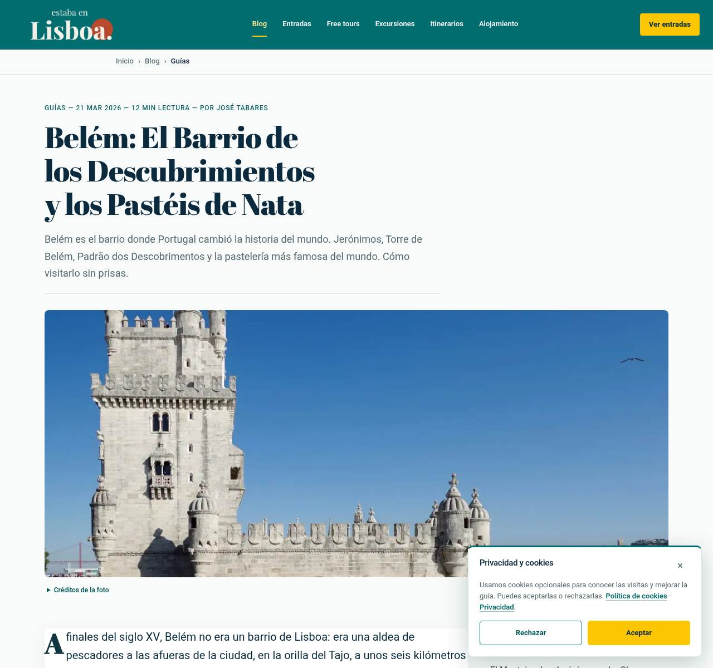 | 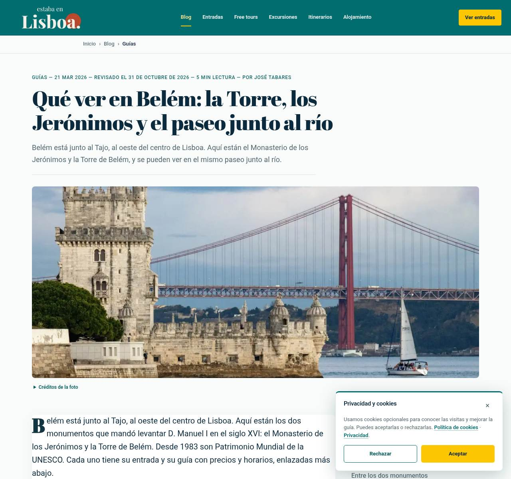 |
