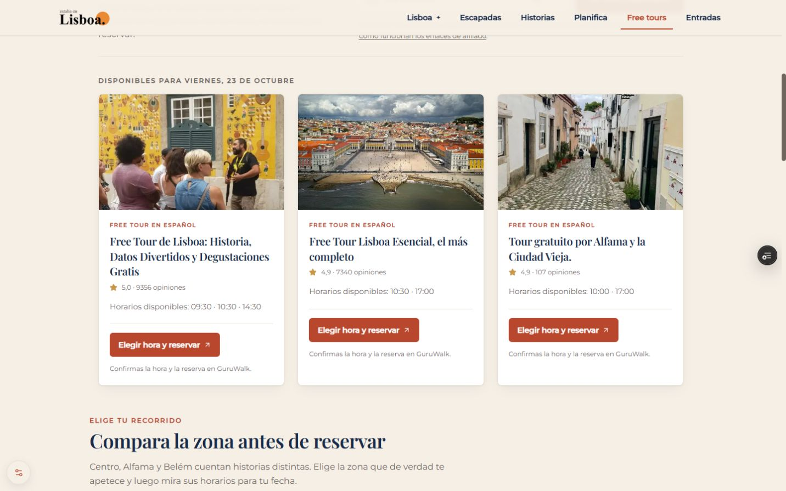
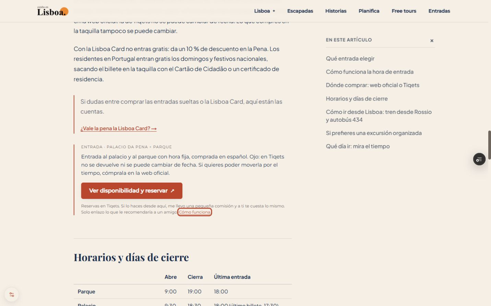

# Entradas y Free tours: auditoría y prueba comercial acotada

22 de octubre de 2026. **Candidato en rama `commercial-booking-paths`, sin publicación.** Base: `5d3573d3c09ae9d804d0636fc47feac8ed28f563`, merge aprobado del PR #113. El cierre documental de esa publicación vive también en el PR #114; no se incorpora ni fusiona automáticamente aquí. Mente Lisboa y GitHub siguen siendo la fuente de verdad.

## Diagnóstico y evidencia

**HECHOS.** Inventario del HTML de 100 páginas de producción: 98 del sitemap más Entradas y Actividades. Contiene 69 enlaces de los tres proveedores reconocidos: GuruWalk 14, Tiqets 27 y GetYourGuide 28, repartidos por 25 artículos y otras superficies. El recuento incluye los dominios regionales de GetYourGuide, no solo `.com`. No hay incidencias de `sponsored` ni identificadores de afiliado ausentes en ese inventario. No equivale a visitar todos los checkouts ni certificar atribución de comisiones. Excluye enlaces insertados tras hidratar por Stay22 y resultados dinámicos del buscador. [Inventario reproducible](qa/2026-10-22/commercial/production-link-audit.json).

Free tours y Entradas ya están en primer nivel de navegación, desktop y móvil, publicados por PR #113. `/free-tours-lisboa` está indexable y `/comprar-entradas` accesible con noindex/follow según la migración aprobada. No se añaden páginas comerciales ni se cambia indexación en este candidato.

La plantilla editorial publicada por D-045 sitúa las reservas al final, después de todo el contenido y FAQ. A 390 px, el inicio del bloque de Pena está a unos 11.458 px desde el comienzo; Jerónimos a 12.303 y Alfama a 5.221. Son coordenadas de layout con las condiciones del navegador de QA, no profundidad de scroll de visitantes reales. [Baseline](qa/2026-10-22/commercial/booking-before.json).

Se comprobó el buscador real de producción para el 23/10/2026: tres tours y siete horarios, con referido conservado. Varias horas comparten exactamente la misma URL por fecha; los botones anteriores «Reservar 09:30» no seleccionan esa hora en el destino. No se hizo ninguna reserva ni clic afiliado de prueba. [Resultado observado](qa/2026-10-22/commercial/live-finder-before.json).

**DATOS NO DISPONIBLES.** Windsor.ai bloquea lecturas porque la cuenta tiene tres conexiones y su plan gratuito admite una. La respuesta contiene un aviso de bloqueo en los campos de texto y ceros de sustitución: no son datos reales. No se han desconectado fuentes ni cambiado planes. GA4 activo conocido: `520462797`; segunda propiedad `547224276`, no mezclar sin verificar. Intento de lectura: 23/09–20/10/2026, hostnames públicos exactos. José no sabe si existen reservas/comisiones: estado DESCONOCIDO, no cero. Los 33 clics históricos hasta septiembre no son una medición actual.

**HIPÓTESIS.** Una oferta relevante situada tras resolver su decisión puede resultar más fácil de encontrar que al final de una guía larga. El exceso de botones que llevan al mismo lugar puede confundir. No hay datos actuales que demuestren que estos factores hayan reducido ventas o causado la bajada de impresiones.

## Propuesta / razón / impacto / esfuerzo

Probar tres traslados manuales de ofertas existentes, sin aumentar su número y sin cambiar destinos, afiliados o condiciones:

| Página | Tras responder | Oferta trasladada | Resto |
|---|---|---|---|
| `/blog/palacio-da-pena-entradas` | Dónde comprar: web oficial o Tiqets | Pena + parque, Tiqets | Excursión de Sintra al final |
| `/blog/monasterio-jeronimos-entradas` | Dónde comprar la entrada | Jerónimos, Tiqets | Combinada Jerónimos + Torre de Belém al final |
| `/blog/alfama-historia-guia` | Ruta a pie por Alfama | Free tour de Alfama, GuruWalk | Castelo de São Jorge al final |

Máximo una oferta en cuerpo y otra final. La respuesta, comparación con la web oficial, restricciones y fuentes se mantienen. Etiqueta de entradas: «Ver disponibilidad y reservar». Aviso afiliado visible. Pena/Jerónimos son páginas protegidas: sin reescritura, cambios SEO o datos nuevos. El resto del blog conserva D-045. Si desaparece el heading o ID configurado, la oferta vuelve al módulo final y no se pierde.

En el buscador se agrupan horarios con URL idéntica: horas como texto, un botón «Elegir hora y reservar» y aclaración «Confirmas la hora y la reserva en GuruWalk». Si el proveedor entrega URLs distintas, se conservan todas. Enlaces originales completos, sin reconstruir ni perder referido/fecha. Botones de al menos 44 px y nombre accesible que incluye la etiqueta visible. La medición agrupa esos clics por tour cuando hay un único destino; no comparar directamente el antiguo `affiliate_content` de evento con el nuevo de tour.

Impacto esperado: facilitar la transición respuesta → reserva. No prometer ventas, porcentaje de conversión ni ingresos. Esfuerzo bajo; riesgo editorial acotado por configuración explícita y pruebas de preservación.

## Stay22: hallazgo separado

En producción hidratada con consentimiento, Spark introduce enlaces de alojamiento en menciones de barrios de Free tours. Puede distraer, pero no demuestra pérdida de reservas. Los enlaces manuales de GuruWalk observados siguen intactos. No se modifica Stay22, sus exclusiones de GetYourGuide ni su consentimiento.

La [documentación oficial de Spark](https://blog.stay22.com/meet-spark-the-brilliant-ai-affiliate-link-creator) describe esa inserción y remite al equipo de soporte/Partner Success para desactivarla. No se ha verificado un parámetro local de opt-out; no se inventa. Próximo paso separado: confirmar con el proveedor si admite exclusión por página o desactivación de Spark manteniendo los enlaces manuales. No se envía ningún mensaje en nombre de José.

## Plan priorizado

| Orden | Acción | Impacto esperado | Esfuerzo / estado |
|---|---|---|---|
| 1 | Verificar reservas, cancelaciones y comisión neta en GuruWalk/Tiqets/GetYourGuide para el mismo periodo | Saber si el embudo genera ingresos reales | Bajo; dato pendiente, no credenciales en chat |
| 2 | Recuperar lectura GA4 sin borrar conexiones automáticamente; comparar periodos finalizados | Evitar optimizar a ciegas | Bajo; límite externo de Windsor |
| 3 | Revisar visualmente esta Preview: tres reservas contextuales y buscador con destino claro | Menos fricción de decisión | Bajo; preparado |
| 4 | Medir clics de las tres URLs por proveedor/campaña y placement, y resultados por proveedor | Decidir mantener o revertir con evidencia | Medio; solo tras eventual publicación |
| 5 | Revisar Spark en páginas de experiencias con soporte oficial | Reducir desvíos de intención | Bajo/medio; configuración externa pendiente |
| 6 | Comprobar producto, condiciones y apertura de cada enlace antes de ampliar el piloto | Proteger confianza y correspondencia | Medio; no cambiar los 69 enlaces en bloque |
| 7 | Ampliar únicamente a otra página con demanda comercial y señal suficiente | Escalar lo demostrado | Medio; no autorizado en este lote |
| 8 | Reevaluar indexabilidad de Entradas con GSC + utilidad diferencial completa | Valorar captación comercial orgánica | Medio; mantener noindex actual hasta decisión explícita |

## Medición y criterio de decisión

D0 será la publicación confirmada, no el push ni la Preview. Antes, recuperar baseline GA4 de 28 días finalizados por página, partner, campaña y placement. Consentimiento obliga a interpretar clics como muestra incompleta. Reservas confirmadas/comisión neta se toman del dashboard del partner, con fecha y ventana de atribución; no emparejar personas ni inferir reserva desde un clic.

A 14/28 días después de D0, comparar clics afiliados por visita medida de cada página y dispositivo con periodo anterior comparable. Separar buscador de landing y blogs. Si no hay al menos 100 visitas medidas por superficie o el volumen es muy escaso, ampliar ventana y declarar inconcluso. Es un umbral operativo de lectura, no significancia estadística. No es A/B aleatorio; temporada, cambios de tráfico y publicación editorial son factores de confusión. Registrar si no se puede obtener un denominador compatible.

Mantener si hay uso consistente del CTA, atribución intacta y utilidad editorial conservada; ampliar solo con señal suficiente y reservas verificadas cuando estén disponibles. Revertir si hay pérdida de parámetros, salto prematuro antes de la respuesta, distracción clara o errores. Una muestra pequeña sin ventas no justifica una migración SEO. Metas de proceso: 30 días con un registro reconciliado clics/reservas; 60 días con decisión sobre las tres páginas; 90 días con un único siguiente lote basado en evidencia. Sin previsiones inventadas de euros.

## URLs retiradas: respuesta comprobable

Este candidato y PR #113 no retiran URLs adicionales. La Fase 1 anterior configuró estas 16 reglas 301; no todas eran URLs nuevas activas, algunas eran aliases históricos:

| Origen | Destino definitivo |
|---|---|
| `/transporte` | `/blog/como-moverse-por-lisboa` |
| `/transporte-lisboa` | `/blog/como-moverse-por-lisboa` |
| `/apps` | `/blog/mejores-apps-lisboa` |
| `/presupuesto` | `/calculadora-presupuesto-lisboa` |
| `/blog/tarjeta-lisboa-card-vale-pena` | `/blog/lisboa-card-vale-la-pena` |
| `/blog/barrios-lisboa-donde-alojarse` | `/blog/donde-alojarse-en-lisboa` |
| `/blog/viajar-ninos-lisboa` | `/blog/lisboa-con-ninos` |
| `/blog/como-ir-sintra-desde-lisboa` | `/blog/sintra-desde-lisboa` |
| `/blog/descubridores-portugueses` | `/blog/descubrimientos-portugueses-lisboa` |
| `/blog/que-hacer-en-lisboa-en-3-dias` | `/itinerarios/lisboa-3-dias-premium` |
| `/itinerarios/lisboa-fotografia` | `/blog/donde-fotografiar-lisboa` |
| `/itinerarios/lisboa-romantica` | `/blog/lisboa-en-pareja` |
| `/free-tour` | `/free-tours-lisboa` |
| `/actividades/tranvia-28` | `/blog/tram-28-historia-guia` |
| `/actividades/mosteiro-jeronimos` | `/blog/monasterio-jeronimos-entradas` |
| `/actividades/sintra-dia-completo` | `/blog/sintra-desde-lisboa` |

Ocho páginas siguen accesibles con noindex/follow: `/comprar-entradas`, `/planifica-tu-viaje`, `/faq`, `/aviso-legal`, `/politica-privacidad`, `/politica-cookies`, `/terminos-condiciones`, `/actividades`. Esto las excluye de estrategia SEO, no las borra. `/free-tours-lisboa` sigue indexable. Sitemap actual: 98 URLs; el número no se interpreta como 16 artículos eliminados. `/quiz` ya era 404 histórico. Restaurantes/Pareja y Novedades/Festivales siguen sin fusionarse (D-055). Ninguna de esas decisiones se cambia aquí.

## Archivos y QA

- `src/data/contextual-booking-placements.ts`: whitelist manual de tres páginas.
- `src/components/blog/ArticleBody.tsx`: traslado con fallback y sin duplicación.
- `src/lib/free-tour-booking-options.ts`, `FreeTourLiveFinder.tsx`: destinos únicos y etiquetas claras.
- `scripts/test-free-tour-options.mjs`, `package.json`: tres pruebas de agrupación, preservación de URL y fallback.
- `scripts/smoke-editorial-template.mjs`: contrato exacto de colocación y preservación de todos los enlaces previos, no solo prohibición de nuevos.
- `scripts/smoke-tiqets.mjs`: normaliza CRLF en lecturas de fixtures; el primer intento local fallaba al contar productos por saltos Windows. No se cambian catálogo ni expectativas.
- Este informe, evidencias y Mente Lisboa: diagnóstico, límites y D-067.

Validación local: build137; TypeScript correcto; lint cero errores y un warning previo de `analyticsParams` en `ItineraryContextualCta.tsx`. Tres pruebas del buscador y seis de analítica correctas. Preservación editorial: 72 páginas/1.659 comprobaciones. Migración: 1.426, 16 reglas 301 a 200 en un salto; calidad técnica 1.130/113 páginas; navegación171; sitemap64/98 URLs; Free tours66 y Tiqets correctos. Sin cambios de robots, canonical, schema, metadata, sitemap, enlaces internos o política de indexación. Doce vistas DOM de las tres páginas a 320/390/768/1440, un H1, sin overflow y botones >=48 px. [Medidas posteriores locales](qa/2026-10-22/commercial/booking-after-local.json). Revisión React: sin nuevos efectos/fetches/cascadas, sin dependencias, claves de destino únicas y cálculo puro; consentimiento y allowlist de hosts conservados.

No se ha repetido Lighthouse: no nuevas imágenes, scripts externos ni peticiones; no afirmar mejora de Core Web Vitals. Falta QA remota con entorno real y revisión visual de José antes de producción (L-003). Preview/commit exacto y resultados remotos se añadirán al cerrar el candidato.

## Decisión

**PROBAR**, sin merge ni publicación automática. Una oferta contextual existente en tres páginas y un buscador más claro. Conservar URLs protegidas, navegación comercial visible, afiliación, privacidad y política SEO. No intentar compensar falta de métricas añadiendo más enlaces. Siguiente acción concreta: comprobar la Preview y mostrarla a José.

## Cierre del candidato en Preview

[PR #115, borrador](https://github.com/josetabares24-png/portugal-autentico-v2/pull/115). Aplicación comprobada **48b778dfef16d37d1e7050ca455aa4dae49b5922**; deployment **dpl_8MX88g47VxgX4GFVxFYQZypWBbSd**, READY, entorno Preview. [URL del deployment](https://portugal-autentico-v2-c5cfcyxpx-estabaenlisboa.vercel.app/free-tours-lisboa); requiere sesión Vercel o enlace temporal, que no se guarda en Git. Los cinco checks publicados por GitHub para este SHA están correctos, sin pendientes. No se fusiona el PR ni se publica.

QA remota: preservación editorial1.659/72, migración1.328, técnico1.130/113 y Free tours66, cero fallos. La diferencia de98 checks de migración frente al local corresponde a la cabecera noindex de protección de Preview; las reglas del HTML siguen comprobándose. [Resumen y límites](qa/2026-10-22/commercial/summary.json).

| Inicio de la reserva principal a390 px | Producción antes | Preview después |
|---|---:|---:|
| Pena | 11.458 px | 6.571 px |
| Jerónimos | 12.303 px | 6.330 px |
| Alfama | 5.221 px | 3.194 px |

Coordenadas desde el comienzo del documento, mismo ancho y fuente; no CTR ni scroll observado de visitantes. Doce vistas remotas de artículos a320/390/768/1440 sin overflow, un H1 y botones de48 px o más. Cuatro vistas adicionales del buscador con tres resultados reales: tres botones, destinos/ref/fecha intactos y44 px o más. Capturas verificadas en móvil y escritorio. Teclado: foco visible en la divulgación del bloque de Pena; no se abrió checkout ni se enviaron eventos de producto desde Preview (host excluido).

El resultado dinámico del 23/10 mantiene tres tours y siete horas; solo las URLs idénticas se agrupan. Disponibilidad y opiniones pueden variar, no son catálogo hardcodeado. No se repite Lighthouse ni se afirma mejora de rendimiento/conversión. Cierre documental posterior conserva exactamente los archivos de aplicación del SHA probado. D0 de E-018 sigue sin iniciar.

Producción continúa en5d3573d (PR113). La próxima acción es revisión visual del candidato por José; la limitación de Windsor y los dashboards desconocidos no se convierten en un permiso para cambiar cuentas, atribución o SEO.
