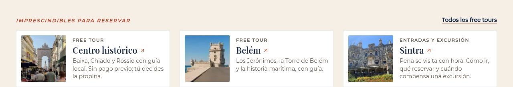
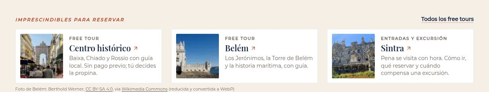
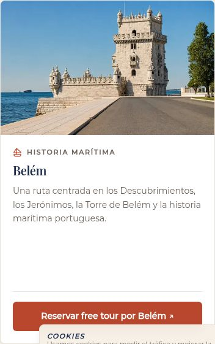
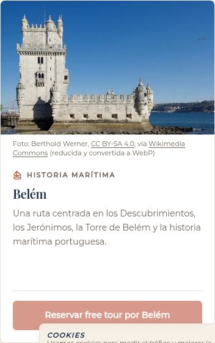
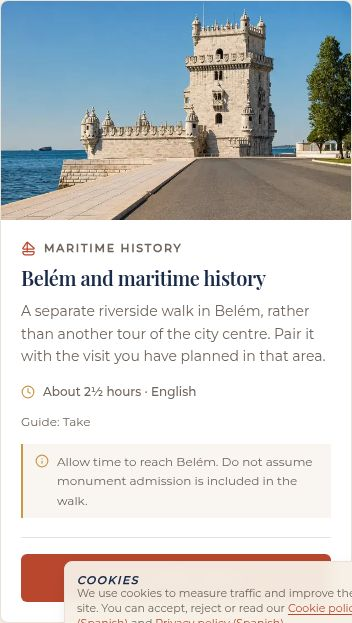
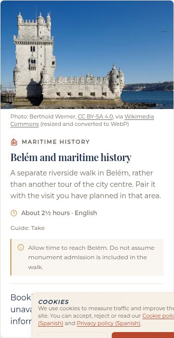

# Foto de la Torre de Belém: de IA a Wikimedia Commons, con crédito visible (1/11/2026)

En la Home, en /free-tours-lisboa y en la guía de free tours en inglés, la foto de IA `/images/actividades/torre-de-belem-lisboa.webp` pasa a ser `/images/commons/torre-belem-werner-wikimedia.webp`, la misma del PR #132: Berthold Werner, CC BY-SA 4.0, [ficha en Commons](https://commons.wikimedia.org/wiki/File:Lisbon_Torre_de_Bel%C3%A9m_BW_2018-10-03_16-35-08.jpg). No cambian URLs, textos, alts ni enlaces de afiliado. El archivo de IA sigue en `public/`, porque `smoke:sitemap` comprueba que exista.

## Archivos tocados
- **`src/components/home/HomeEssentials.tsx`:** cambia la foto de la tarjeta "Belém". Toda la tarjeta es un enlace y no se puede meter otro enlace dentro, así que el crédito va en un pie bajo la fila: "Foto de Belém: Berthold Werner, CC BY-SA 4.0, vía Wikimedia Commons (reducida y convertida a WebP)", con la licencia y la ficha enlazadas.
- **`src/data/affiliate-links.ts`:** foto de la ruta "Belém" (`FREE_TOUR_ROUTES`, en /free-tours-lisboa).
- **`src/app/[locale]/free-tours-lisboa/page.tsx`:** crédito visible bajo la foto de cada ruta que use una foto de Commons; ahora solo Belém.
- **`src/data/english-walking-tours.json`:** foto del tour 35074 (Belém).
- **`src/components/english/EnglishTourSelection.tsx`:** crédito en inglés bajo la foto (/en/lisbon-free-walking-tours).
- **`src/components/free-tours/FreeTourLiveFinder.tsx`:** la foto de reserva por si un tour no trae imagen (`FALLBACK_IMAGES`). El crédito sale bajo la foto cuando la que se ve es de Commons, incluidas las fotos locales de los tours en inglés. El `` lleva width/height 640×400 (16:10, como su contenedor).
- **`src/components/ui/PhotoCreditLine.tsx`** (nuevo): crédito corto con autor, licencia enlazada y "vía Wikimedia Commons" enlazado. No pinta nada si la foto no está en `photo-credits.ts`.
- **`src/data/photo-credits.ts`:**
  - Entradas de la Torre (Werner) y del claustro (Hałun), idénticas a las del PR #132.
  - Campo `unmodified` y función `photoAdaptation()`: todos los créditos visibles añaden "(reducida y convertida a WebP)". Esto incluye las tarjetas de reserva (`BookingCard`, a través de `formatPhotoCreditShort`).
- **`public/images/commons/`:** `torre-belem-werner-wikimedia.webp` y `claustro-jeronimos-halun-wikimedia.webp`, más `CREDITOS.md`. Son idénticos a los del PR #132, para que el orden de fusión dé igual.

Las imágenes con `fill` (Home, /free-tours-lisboa, inglés) no llevan width/height porque next/image no lo permite con `fill`. Van en un contenedor de proporción fija, así que no hay salto de diseño.

## Otras referencias a las fotos de IA de la Torre y del claustro (`grep` en `src`)
`ticket-guides.ts`, `bookings.ts`, `activities.ts`, `blog-posts.ts`, `src/lib/media.ts` y `blog/[slug]/page.tsx` ya las cambia el PR #132. Este PR no las toca para no chocar con él. Con los dos PR fusionados, `src` no vuelve a usar `torre-de-belem-lisboa.webp` ni `mosteiro-dos-jeronimos-claustro.webp`.

## Para decidir: otros artículos con horario o precio de la Torre y los Jerónimos (no se tocan)
La referencia es `v4/research/belem.md`, comprobado el 31/10/2026 en la web oficial (/visitar) y en la venta oficial MEO Blueticket. El PR #132 quitó la hora de apertura de la Torre porque dos páginas oficiales no coinciden; José tiene que confirmarla.

- **`/blog/monumentos-de-lisboa`** (`page.tsx` en `main`, línea 4966, Jerónimos): "Datos prácticos: el claustro abre de martes a domingo de 9:30 a 17:30 (última entrada a las 17:00) y cierra los lunes. La iglesia es gratuita; lo que se paga es el claustro: 18 € de tarifa base; la taquilla online consultada muestra 19,11 €…"
  - Coincide con la web oficial y la venta oficial a 31/10/2026: 9:30–17:30, última entrada 17:00, 18 € y 19,11 € online.
  - Falta: no dice que también cierra el 1 de enero, el Domingo de Pascua, el 1 de mayo, el 13 de junio y el 25 de diciembre.
- **`/blog/monumentos-de-lisboa`** (línea 4969, Torre): "Datos prácticos: abre de martes a domingo de 9:30 a 17:30 y cierra los lunes. Precio: 15 € de tarifa base; la taquilla online consultada muestra 15,92 €… El interior tiene 5 pisos con vistas al río desde la terraza superior, pero las escaleras son muy estrechas. Tiempo: 45 minutos."
  - 15 € y 15,92 € coinciden con la venta oficial.
  - La hora 9:30 está pendiente de confirmar.
  - "5 pisos", "escaleras muy estrechas" y "45 minutos" no tienen fuente: son las mismas afirmaciones que quitó el PR #132.
- **`/blog/lisboa-en-enero`** (líneas 1572–1573, tabla): "Torre de Belém | 15 €, con franja horaria | Martes a domingo, 9:30 a 17:30 | Lunes y 1 de enero" y "Jerónimos (claustro) | 18 €, con franja horaria | Martes a domingo, 9:30 a 17:30 | Lunes y 1 de enero".
  - Línea 1576: "La Torre y los Jerónimos tienen la última entrada a las 17:00."
  - Precios, cierres de enero y última entrada coinciden. La hora de la Torre está pendiente.
- **`/blog/novedades-lisboa-2026`** (línea 4812): "la Torre de Belém reabrió el 27 de mayo de 2026 después de casi un año de obras. La entrada ahora va por franjas horarias, con un máximo de unas 900 personas al día (60 por franja), de martes a domingo de 9:30 a 17:30 y última entrada a las 17:00."
  - "900 al día", "60 por franja" y la fecha de reapertura no están en `belem.md`: no se encuentran en la web oficial ni en la venta oficial.
  - La hora 9:30 está pendiente.
- **`/blog/belem-barrio-guia`** (líneas 5253–5256 en `main`): "cinco pisos con escaleras estrechísimas… 9:30 a 17:30… colas de una hora". Ya lo reescribe el PR #132.

## Pruebas (build local)
- `typecheck`, ESLint de los archivos tocados y `build`: OK.
- `smoke:sitemap`: 67/67.
- `smoke:seo-migration`: 1530 comprobaciones, 0 fallos (107 URLs, 16 redirecciones).
- `smoke:technical-quality`: 1220 comprobaciones, 0 fallos.
- **Diff de URLs:** el sitemap local es idéntico al de producción (107 URLs).
- El crédito "Berthold Werner" aparece en /, /free-tours-lisboa y /en/lisbon-free-walking-tours. Ya no queda ninguna referencia a `torre-de-belem-lisboa` en el HTML de esas páginas.

## Capturas (antes: producción; después: build de esta rama)
| Sitio | Antes | Después |
|---|---|---|
| Home, "Imprescindibles" |  |  |
| /free-tours-lisboa, ruta Belém |  |  |
| /en/lisbon-free-walking-tours, tour de Belém |  |  |
