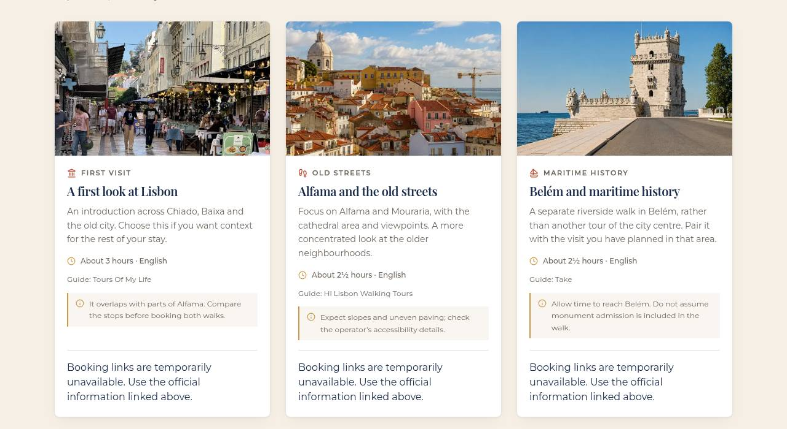
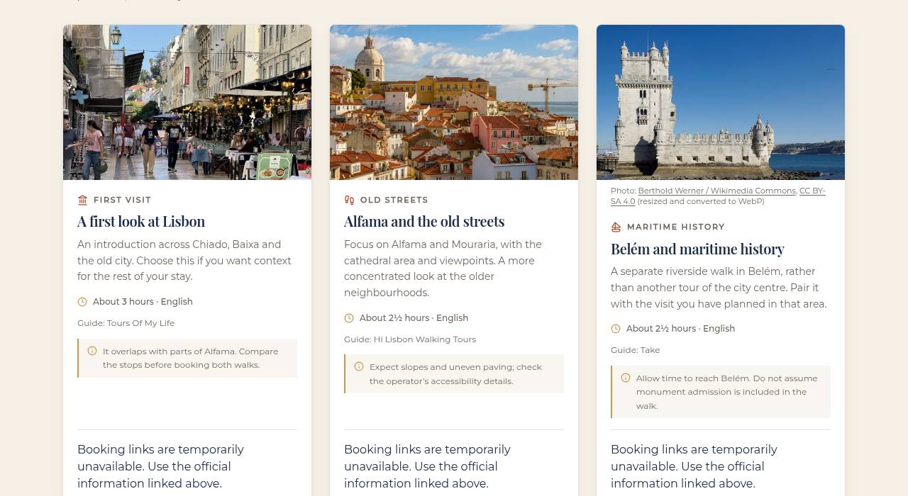

# Foto de la Torre sin IA en free tours en inglés y Home (2 de noviembre de 2026)

Sustituye al PR #133, que chocaba con `main` tras el rediseño (7e7aa32).

## Qué ya traía main

- `affiliate-links.ts` (categoría Belém de free tours) y el buscador de free tours (`FreeTourLiveFinder`) ya usan la foto de Berthold Werner con `PhotoAttribution`.
- `photo-credits.ts`, `CREDITOS.md` y los archivos de `public/images/commons/`.

## Qué faltaba

`/images/actividades/torre-de-belem-lisboa.webp` sigue siendo el mismo archivo (mismo blob `25beece`) que José dijo que hizo con IA. Aún salía en:

- `/en/lisbon-free-walking-tours`, tarjeta "Belém and maritime history" (`english-walking-tours.json`). También la usa el buscador en directo en inglés como imagen de respaldo.
- `HomeEssentials.tsx`. El componente no se usa en la Home actual del rediseño, pero se cambia para que no vuelva si se reutiliza.

## Cambios

- La tarjeta inglesa usa la foto de Werner (CC BY-SA 4.0) con un pie visible: autor y Wikimedia Commons enlazados, licencia enlazada y "resized and converted to WebP". No va en un `
` porque `smoke:english-pilot` prohíbe desplegables en esas tarjetas.
- `PhotoAttribution` acepta `lang="en"` ("Photo credits", "resized and converted to WebP"); en español no cambia nada. El buscador en directo se lo pasa según el idioma.
- `HomeEssentials`: foto de Werner y `PhotoAttribution` bajo cada tarjeta.

## Comprobaciones (build local, 2/11/2026)

typecheck y build OK; lint 0 errores (2 avisos que ya están en main). smoke:sitemap 67/67, smoke:seo-migration 1530/0 (108 URLs), smoke:technical-quality 1220/0, smoke:grok-redesign 45/0, smoke:grok-rendered 27/0, smoke:free-tours 12/12, test:english-tours y test:free-tour-options OK. smoke:english-pilot tiene los mismos 2 fallos que main. Sitemap idéntico al de main.

## Capturas (/en/lisbon-free-walking-tours, escritorio, build local)

| Antes (main) | Después |
|---|---|
|  |  |
